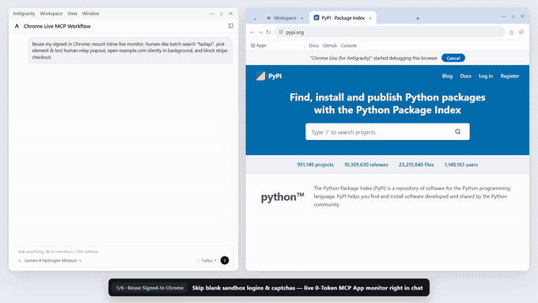
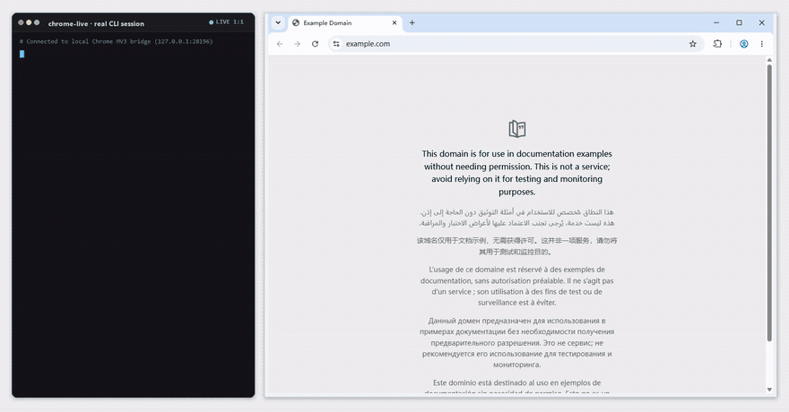

# Chrome Live (for Antigravity)

[](https://github.com/CHANPAJN/chrome-live-for-antigravity/actions/workflows/ci.yml) · [中文文档](./README.zh-CN.md) · **GPL-3.0** · **Zero Dependencies**

> Independent community project. Not affiliated with or endorsed by Google LLC or Meta Platforms, Inc.

Connect Antigravity (or Claude Code, Codex, OpenCode, and any CLI / MCP agent) directly to your everyday signed-in Chrome or Edge browser—no blank sandbox profiles, no repeated login loops, and no third-party npm packages.

<p align="center">
  
</p>

<details>
<summary>View raw 1:1 Chrome window + live CLI capture</summary>
<p align="center">
  
</p>
</details>

---

## Why I Built This

Running browser tasks through headless Playwright or sandboxed MCP servers gets frustrating quickly:

1. Every session starts logged out, hits captchas or 2FA prompts, and requires downloading hundreds of MBs of browser binaries.
2. Step-by-step tool loops (`open -> snapshot -> type -> click -> wait -> snapshot`) burn 6–8 agent turns and hundreds of thousands of tokens for a simple search.
3. Background tasks constantly steal window focus, and when a page hits a QR login or captcha, the whole workflow stalls.

Chrome Live pairs a local Node.js daemon (`127.0.0.1:28196`) with a plain Manifest V3 extension to work alongside your real browser instead:

- **Share one signed-in tab on demand**: Press `Alt+Shift+L` (`Option+Shift+L` on macOS) to hand the active tab to your agent. Running `done` detaches the debugger and never closes your shared tab.
- **Auto-collapsing background tab group**: Research tabs open quietly inside a cyan **`Live · Active`** tab group that automatically collapses into a compact pill without pulling Chrome to the front.
- **Human-like motion & instant pause**: Cursor movement follows Bezier curves with approach deceleration and staggered typing cadence. A floating HUD bar at the bottom of the page lets you click Pause (or hold left-click for 3 seconds) to take over immediately.
- **Built-in Antigravity MCP App (SEP-1865)**: Streams a 0-token live preview inline in chat (`chrome_live_monitor`), docked in the side pane, or full-page in the sidebar (`chrome_live_workspace`), with 6 built-in controls:
  - **Control**: Click, scroll, and type directly on the live stream;
  - **Pick**: Drag a bounding box on the preview to extract real DOM selectors (traversing open Shadow DOM) straight into chat;
  - **Attach**: Push the active tab's title, URL, and `tabId` into the next prompt via `ui/update-model-context`;
  - **Popout / Merge**: Pop a controlled tab into a standalone window for manual 2FA/captcha, then merge it back to its original tab index for the agent to continue.
- **Single-roundtrip `batch` + opt-in local Site Playbooks**: Pipe `open -> type -> click -> wait -> snapshot -> done` through stdin in one turn. Turn on `playbook on` (disabled by default) to store learned routes and selectors locally in `~/.chrome-live-antigravity/site-playbooks.json` (sensitive query params stripped automatically).
- **Concurrent clean extraction & full form state**: `extract` reads multiple pages in parallel background tabs (filtering `<style>`/`<script>` noise) and closes worker tabs when finished. `snapshot` traverses open Shadow DOM and exposes `{DISABLED}`, `{checked}`, `{selected}`, `{expanded}`, and validation alerts.
- **Local guardrails & zero dependencies**: Built entirely on Node.js >= 20 standard modules and vanilla MV3 JavaScript—0 npm packages, 0 prebuilt binaries. Payment gateways (Stripe, PayPal, Alipay, banking portals), `chrome://`, and `/checkout` routes (including SPA hashes) are blocked locally before touching Chrome; CDP uploads reject `.ssh`, `.env`, and `.aws` paths.

---

## Benchmarks (PyPI Multi-Step Workflow)

Task: open `pypi.org` → type query → submit → wait → extract results → cleanup (measured from actual session token logs):

| Mode | Agent Turns | Wall Time | Total Token Throughput | Non-Cached Tokens |
| :--- | :---: | :---: | :---: | :---: |
| Classic step-by-step loop (`open → snapshot → type → click → wait → snapshot → done`) | 7 | 71.0s | 419,162 | 20,360 |
| Single-roundtrip `batch --compact` | **1 (-85.7%)** | **13.0s (5.5× faster)** | **67,365 (-83.9%)** | **2,445 (-88.0%)** |
| Repeat visit with `playbook on` | **1 (-85.7%)** | **10.0s** | Skips landing page discovery | — |

Background footprint: `< 0.01%` idle CPU (`0.0096%` measured), `~30–34 MB` private memory, `~3s` automatic extension reconnect after daemon restart, `< 100ms` local guardrail checks.

---

## Quick Start

### Option 1: Let your AI agent install it

Send this prompt to Antigravity, Claude Code, Codex, OpenCode, or Cursor:

```text
Read https://github.com/CHANPAJN/chrome-live-for-antigravity/blob/main/AI_INSTALL.md and follow it step by step to clone and configure chrome-live-for-antigravity, generate the local pairing token, start the bridge daemon, and return the local extension/ folder path for me to load in chrome://extensions.
```

### Option 2: Manual 3-step setup

**1. Clone and generate a local pairing token**

```bash
git clone https://github.com/CHANPAJN/chrome-live-for-antigravity.git
cd chrome-live-for-antigravity
node ./bin/chrome-live.mjs setup
```

`setup` creates a random 256-bit token at `~/.chrome-live-antigravity/auth.token` (`0600`) and writes a gitignored `extension/.local-runtime.json` so the extension connects automatically on first load.

**2. Load the unpacked extension (Chrome / Edge / Brave)**

> Recent Chrome stable builds (137+) removed the `--load-extension` CLI flag. Load it once from the extensions page:

1. Open `chrome://extensions` (or `edge://extensions`);
2. Enable **Developer mode**;
3. Click **Load unpacked** and select this repository's `extension/` directory;
4. Verify the bridge connection:

```bash
node ./bin/chrome-live.mjs health
```

**3. Connect Antigravity or any MCP client**

Nothing is written to `~/.gemini/config/` until you opt in:

- **Install the Antigravity plugin (Skill + Live Monitor Sidecar)**:

```bash
node ./bin/chrome-live.mjs install --with-plugin
```

- **Or mount as a standard `stdio` MCP server (Claude Code / Codex / OpenCode)**:

```json
{
  "mcpServers": {
    "chrome-live": {
      "command": "node",
      "args": ["/absolute/path/to/chrome-live-for-antigravity/bin/chrome-live.mjs", "mcp"]
    }
  }
}
```

---

## CLI Cheat Sheet

```bash
node ./bin/chrome-live.mjs health                          # Check daemon & extension status
node ./bin/chrome-live.mjs open "https://example.com"      # Open URL in collapsed background group
node ./bin/chrome-live.mjs snapshot                        # Capture indexed elements [0],[1] & text
node ./bin/chrome-live.mjs click 0                         # Click by index, CSS selector, or label
node ./bin/chrome-live.mjs type "Search" "query" --submit  # Type into field and submit
node ./bin/chrome-live.mjs upload "./demo.png"             # Attach local file via CDP
node ./bin/chrome-live.mjs batch - --compact               # Run multi-step stdin pipeline in 1 turn
node ./bin/chrome-live.mjs extract "https://a.com"         # Extract clean text & image URLs in parallel
node ./bin/chrome-live.mjs relay popout                    # Pop tab out for manual 2FA / captcha
node ./bin/chrome-live.mjs relay merge                     # Merge tab back and resume AI control
node ./bin/chrome-live.mjs release                         # Detach control without closing tab
node ./bin/chrome-live.mjs done "Task complete"            # Detach debugger & close worker tabs
```

---

## Security & Architecture Notes

- **On-demand debugger attachment**: `chrome.debugger` (1.3) attaches only during active commands or live streaming and auto-detaches after 18 seconds of idle time.
- **Loopback isolation**: The daemon binds strictly to `127.0.0.1:28196` (override with `CHROME_LIVE_PORT`), validates the `Host` header, rejects browser `Origin` headers with `403`, and checks the local token using `crypto.timingSafeEqual`.
- **Financial & internal-page guardrails**: Blocks payment gateways, banking portals, cloud billing consoles, `chrome://`/`edge://`, and `/checkout`, `/payment`, `/pay`, `/cashier`, `/billing` paths locally. If a controlled tab redirects to a protected domain, the debugger detaches immediately.
- **No host binary patching & clean uninstall**: Never touches Antigravity binaries; closed Shadow DOM, cross-origin payment `<iframe>` elements, and native OS file dialogs stay isolated by the browser sandbox. To uninstall, run `node ./bin/chrome-live.mjs stop`, remove the extension in Chrome, and delete `~/.chrome-live-antigravity`.

## Tests

```bash
npm test
```

## Acknowledgements

Thanks to the [LINUX DO](https://linux.do/) developer community for real-world feedback on multi-agent browser workflows.

## License

Released under [GNU General Public License v3.0](./LICENSE) (`GPL-3.0-only`).
