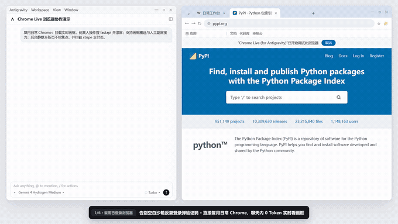
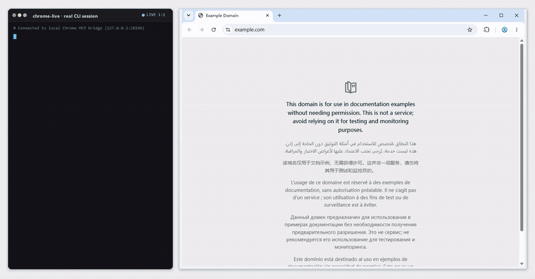

<div align="center">

# chrome-live-for-antigravity

专为 **Google Antigravity** 打造的零依赖 Chrome MV3 桥接与原生 **MCP App（`SEP-1865`）**，支持 Windows、macOS 与 Linux。  
直接复用你日常已登录的 Chrome / Edge 浏览器——聊天内 0 Token 实时画框、防误触禁止点击锁、青 / 黄彩色标签组状态、独立副屏扫码接力与单轮 `batch` 连招，无任何第三方 npm 包或黑盒二进制。

<p>
  <a href="./README.md">English</a> ·
  <b>简体中文</b>
</p>

<p>
  <a href="https://github.com/CHANPAJN/chrome-live-for-antigravity/actions/workflows/ci.yml"></a>
  <a href="./LICENSE"></a>
  <a href="https://nodejs.org"></a>
  <a href="https://linux.do"></a>
</p>



<sub>独立社区开源项目，与 Google LLC 无关联。</sub>

</div>

<details>
<summary>查看真实 Chrome 窗口 + CLI 原始录屏</summary>
<p align="center">
  
</p>
</details>

## 核心能力

- **复用已登录标签页 + 防误触锁**：按 `Alt+Shift+L`（macOS 为 `Option+Shift+L`）即可把当前已登录标签页交给 Antigravity，告别空白无头浏览器反复登录和过验证码。受控期间自动开启透明防误触护盾（鼠标显示禁止点击圆圈斜杠图标），随时点击底部悬浮状态条的「暂停」或按住左键满 3 秒即可拿回控制权；执行 `done` 只卸载调试器，绝不关闭你的原页面。
- **青 / 黄标签组状态 + 后台自动折叠**：AI 操作时页面归入顶部青色 **`Live · 操控中`** 标签组，后台新开查询页自动折叠成小胶囊，不弹新窗不抢前台焦点；一旦点击「暂停」、长按左键 3 秒解锁或弹出独立副屏人工接手，标签组与视口边框立刻切换为明黄色 **`Live · 已暂停`**，当前归谁操控一目了然。
- **聊天内 0 Token 实时画框 + 多标签同屏切换（`SEP-1865`）**：支持聊天内联（`chrome_live_monitor`）、右侧分屏与左侧全屏工作台（`chrome_live_workspace`），实时画面不消耗模型 Token。支持同时托管多个受控标签页，按 `tabId` 独立隔离帧流并在画框顶栏随时切屏，内置 6 个快捷动作：
  - **接管**：直接在画框里远程点击、滚轮翻页和输入文字；
  - **圈选**：在画框上拉框选区域，穿透开放 Shadow DOM 提取真实选择器和文本发回对话；
  - **挂入**：把当前页面标题、URL 和 `tabId` 附到下一条提示词上下文；
  - **副屏 / 归队**：遇到扫码或人机验证时一键弹出独立小窗手动处理，完成后点「归队」或直接点右上角 `×` 关掉副屏窗口，都会自动带登录态归队回原主窗口原位交还 AI；
  - **刷新 / 释放**：手动拉取最新一帧，或立即解除受控并卸载调试器。
- **拟人化交互、单轮 `batch` 连招与并发正文提取**：鼠标移动带贝塞尔曲线轨迹与接近减速，打字带错落间隔；支持通过 stdin 把 `open → type → click → wait → snapshot → done` 合并为 1 轮调用；`extract` 在后台标签页并发抓正文和原图直链、抓完即关；`snapshot` 穿透开放 Shadow DOM，准确标出 `{DISABLED}`、`{checked}`、`{selected}`、`{expanded}` 与页面校验报错。
- **按需开启的本地站点路书（`playbook on`，默认关闭）**：代码默认 `false`。在扩展侧边栏或命令行开启后，自动剔除敏感与追踪查询参数，在本地 `~/.chrome-live-antigravity/site-playbooks.json`（`0600` 权限）记录直达路由、稳定 CSS 选择器与避坑提示，二次访问同域名直接跳过摸索。

## 实测对比

测试场景：打开 `pypi.org` → 输入搜索词 → 提交 → 等待加载 → 提取结果 → 清理收尾（基于底层会话账单实测）：

| 模式 | 对话轮次 | 总耗时 | 总 Token 吞吐 | 非缓存净消耗 |
| :--- | :---: | :---: | :---: | :---: |
| 传统逐步调用（`open → snapshot → type → click → wait → snapshot → done`） | 7 轮 | 71.0s | 419,162 | 20,360 |
| `batch --compact` 单轮连招 | **1 轮（-85.7%）** | **13.0s（提速 5.5 倍）** | **67,365（-83.9%）** | **2,445（-88.0%）** |
| 开启本地路书（`playbook on`）二次访问 | **1 轮（-85.7%）** | **10.0s** | 跳过首页直接定位 | — |

常驻后台占用实测：空闲 CPU `< 0.01%`（实测 `0.0096%`），私有内存约 `30–34 MB`，守护进程重启后扩展约 `3 秒` 自动重连，本地安全拦截耗时 `< 100ms`。

## 安装

需本机已安装 `Node.js >= 20`，无需 `npm install` 任何第三方依赖。

**AI 对话一键配置**（直接粘贴给 Antigravity，详见 [AI_INSTALL.md](./AI_INSTALL.md)）

```text
请阅读 https://github.com/CHANPAJN/chrome-live-for-antigravity/blob/main/AI_INSTALL.md ，按步骤帮我克隆并配置好 chrome-live-for-antigravity，生成本地配对口令并启动桥接服务，最后把需要拖入 chrome://extensions 的本地目录路径发给我。
```

**手动安装（3 步）**

**第一步：克隆并生成本地配对口令**（写入 `~/.chrome-live-antigravity/auth.token`，权限 `0600`，并自动生成被 `.gitignore` 忽略的 `extension/.local-runtime.json`）

```bash
git clone https://github.com/CHANPAJN/chrome-live-for-antigravity.git
cd chrome-live-for-antigravity
node ./bin/chrome-live.mjs setup
```

**第二步：加载浏览器扩展（Chrome / Edge / Brave）**  
Chrome `137+` 已移除 `--load-extension`，请在地址栏打开 `chrome://extensions`（Edge 为 `edge://extensions`），开启右上角「开发者模式」，点击「加载已解压的扩展程序」选中仓库下的 `extension/` 目录，再运行检查确认连通：

```bash
node ./bin/chrome-live.mjs health
```

**第三步：接入 Antigravity**（默认不会改动 `~/.gemini/config/`，按需二选一）

```bash
# 方式 A：一键安装 Antigravity 插件（含 SKILL.md 与实时画框面板）
node ./bin/chrome-live.mjs install --with-plugin
```

或手动挂载为标准 `stdio` MCP Server：

```json
{
  "mcpServers": {
    "chrome-live": {
      "command": "node",
      "args": ["/absolute/path/to/chrome-live-for-antigravity/bin/chrome-live.mjs", "mcp"]
    }
  }
}
```

## 使用与命令

```bash
node ./bin/chrome-live.mjs health                           # 查看守护进程与扩展连接状态
node ./bin/chrome-live.mjs open "https://example.com"       # 在后台青色折叠标签组静默打开网页
node ./bin/chrome-live.mjs snapshot                         # 提取带编号元素 [0],[1] 与正文
node ./bin/chrome-live.mjs click 0                          # 按序号、CSS 选择器或按钮文字点击
node ./bin/chrome-live.mjs type "搜索" "关键词" --submit    # 填词并提交
node ./bin/chrome-live.mjs upload "./demo.png"              # 通过原生 CDP 上传本地图片或附件
node ./bin/chrome-live.mjs batch - --compact                # 从 stdin 单轮执行多步连招
node ./bin/chrome-live.mjs extract "https://a.com"          # 后台并发提取正文与原图直链
node ./bin/chrome-live.mjs relay popout                     # 弹出独立副屏供人工处理扫码/验证
node ./bin/chrome-live.mjs relay merge                      # 归队回原窗口原位并交还 AI
node ./bin/chrome-live.mjs release                          # 释放当前页控制权（不关闭页面）
node ./bin/chrome-live.mjs done "任务完成"                  # 断开调试器并清理临时工作页
```

**隐藏顶部「已开始调试此浏览器」提示条幅**

只要扩展挂载 Chrome 原生 `chrome.debugger` API，Chrome 默认会在顶部弹出 `“Chrome Live (for Antigravity)”已开始调试此浏览器 [取消]`（点「取消」会立即断开当前 AI 控制）：

- **默认自动消失**：平时不用手动点取消，任务执行 `done` 或空闲满 18 秒后扩展会自动卸载调试器，条幅随之消失。
- **彻底隐藏条幅（可选）**：完全退出 Chrome 后，给启动命令加上 Chromium 官方参数 `--silent-debugger-extension-api` 即可不再显示：
  - **Windows**：右键桌面或任务栏上的 Chrome 快捷方式 → **属性** → 在「目标」末尾引号**外面**加空格和 `--silent-debugger-extension-api`，确定后重启 Chrome：
    ```text
    "C:\Program Files\Google\Chrome\Application\chrome.exe" --silent-debugger-extension-api
    ```
  - **macOS**：彻底退出 Chrome（`Cmd + Q`）后在终端运行：
    ```bash
    open -b com.google.Chrome --args --silent-debugger-extension-api
    ```
  - **Linux**：命令行运行 `google-chrome --silent-debugger-extension-api`，或在 `~/.local/share/applications/` 对应 `.desktop` 文件的 `Exec=` 末尾追加该参数。

**多标签并发边界与模型提效建议**

- **多开边界**：画框顶栏同时托管并自由切换多个标签页、以及 `extract` 后台并发抓正文均按 `tabId` 严格隔离运行；但涉及多站点富文本发帖、粘贴传图（共用系统剪贴板）或依赖前台焦点的复杂表单时，建议按站点串行执行，避免焦点与剪贴板互相抢占。
- **推荐模型搭配**：
  - **日常查资料、批量抓取、常规单轮 `batch`**：优先用 **Flash / 快速轻量档模型**，工具调用极快、成本低，配合 `batch --compact` 与本地站点路书（`playbook on`）约 10 秒即可完成一次检索闭环；
  - **复杂后台表单、动态 Shadow DOM 控件与排错**：切到 **高推理主力档模型**，对 ARIA 状态提示与复杂交互链路的判断更稳。

## 架构与透明边界

- **按需挂载调试器 & 硬暂停/硬取消**：仅在执行命令或拉流期间挂载 `chrome.debugger`（`1.3`），空闲 18 秒自动卸载释放（空闲 CPU `< 0.01%`）。一旦点暂停、长按左键 3 秒或弹出副屏，扩展会立即停止画面流、卸载调试器并中止执行中的点击/输入兜底；画框 UI 交互动作受仅经 `structuredContent` 投递至隔离沙箱 `ui://` iframe 的 256 位随机能力令牌保护（不写入 `resources/read` 静态 HTML 或 `content`），且仅浏览器内真人手势可解除暂停。点击 Chrome 顶部原生横幅的「取消」会彻底撤销该页授权，绝不偷偷重挂；共享已有登录标签页必须由你在浏览器内手动确认。
- **本地回环隔离与全链路双向 HMAC 零明文鉴权**：守护进程严格监听 `127.0.0.1:28196`（可用 `CHROME_LIVE_PORT` 修改），校验 `Host` 头、拒绝所有网页 `Origin`（`403`）、在读取 POST 包体前先验 HMAC 时间窗与 Nonce、按 RFC 6455 强制校验客户端帧掩码；扩展（WS + HTTP）、CLI、MCP 服务与独立侧栏**全链路采用 HMAC-SHA256 双向请求/响应签名 + Nonce 防重放**（全程 0 字节明文口令走网络）。`auth.token` 设 `0600` 权限，一次性配对文件 `extension/.local-runtime.json` 排除在 `npm pack` 之外并在首次握手成功后自动覆写擦除；快照、容器标签与点击回执绝不读取密码框、草稿框及用户输入值，传出 URL 与链接自动脱敏敏感查询串及 `#hash` 参数。
- **双层金融与暂存箱上传护栏（及如实边界说明）**：守护进程与扩展在 `open`、`navigate`、`batch` 与 `extract` 全链路双层拦截支付网关（支付宝、微信支付、Stripe、PayPal、网银、云账单）、`chrome://` / `edge://` 及 `/checkout`、`/pay`、`/payment`、`/cashier`、`/billing`（含 SPA Hash 路由及页面内可见受保护支付 `<iframe>`）。CDP 文件上传**默认严格限定在专用暂存目录 `~/.chrome-live-antigravity/uploads` 内**（也可通过 `CHROME_LIVE_UPLOAD_DIR` 自定义白名单目录），穿透符号链接（`realpath`）并拒绝多硬链接文件（`nlink > 1`）与 `.ssh`、`.env`、`.aws`、`.pem` 等敏感文件。需注意：域名与路由护栏无法识别普通商家后台里的改价、发货、退款等业务按钮；DOM 脚本不进入跨源 `<iframe>`，但在未命中拦截规则的普通页面上，浏览器级截图与坐标点击仍覆盖当前可见视口；高敏感账号建议放在独立 Chrome 用户配置中使用。
- **零客户端修改、零第三方依赖 & 干净卸载**：全部代码基于 Node.js `>= 20` 内置标准库与明文 MV3 JavaScript 编写，不修改 Antigravity 客户端任何文件；关闭式 Shadow DOM 与系统级文件对话框均受浏览器沙箱隔离不可访问。运行测试或彻底卸载：

```bash
npm test                                                    # 运行安全护栏、协议与端到端集成测试
node ./bin/chrome-live.mjs stop                             # 停止服务后，在扩展页移除扩展并删除 ~/.chrome-live-antigravity
```

## 许可协议

基于 [GNU General Public License v3.0 (GPL-3.0)](./LICENSE) 开源发布。感谢 [LINUX DO](https://linux.do) 社区的交流与反馈支持。
