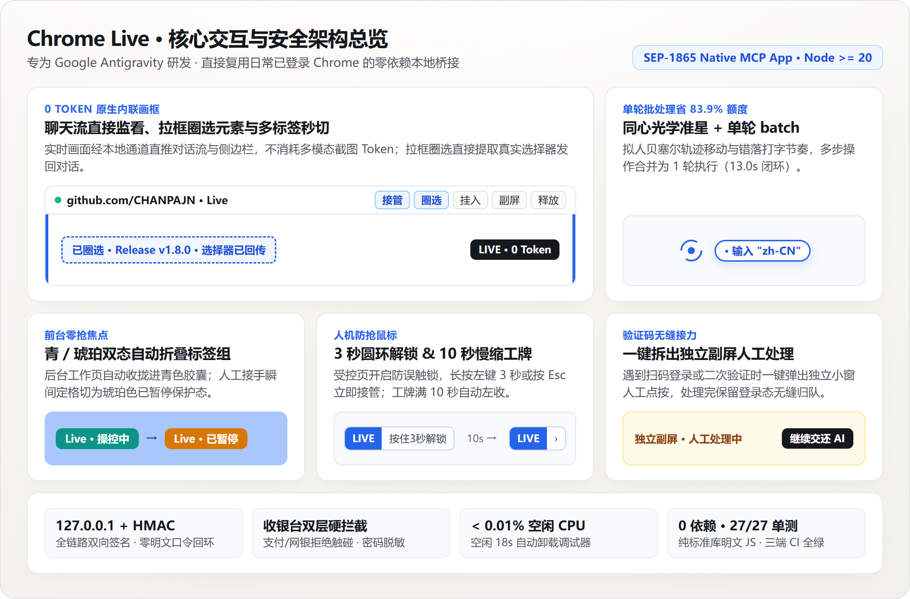
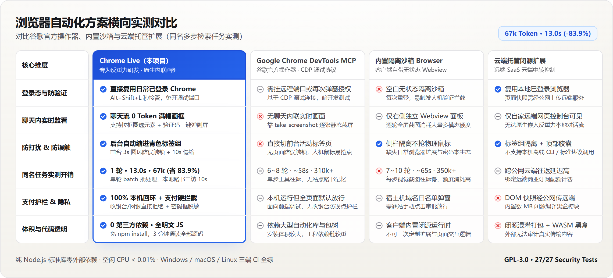
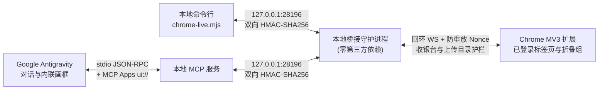

<div align="center">


# chrome-live-for-antigravity

让 **Google Antigravity** 直接操作你电脑上**已经登录好的 Chrome / Edge 浏览器**。  
不用每次在自带的侧边沙盒浏览器里重新输密码、掏手机扫码或过验证；AI 在后台折叠标签组里静默干活不抢鼠标，对话流里还能直接看 0 Token 实时画面。

<sub>支持 Antigravity 正式版 / Insiders / Antigravity IDE / VS Code 官方插件版 · Windows / macOS / Linux · 零第三方 npm 依赖</sub>

<p>
  <a href="./README.md">English</a> ·
  <b>简体中文</b>
</p>

<p>
  
  
  <a href="https://github.com/CHANPAJN/chrome-live-for-antigravity/actions/workflows/ci.yml"></a>
  <a href="./LICENSE"></a>
  <a href="https://nodejs.org"></a>
  <a href="https://linux.do"></a>
</p>


<sub>独立社区开源项目，与 Google LLC 无关联。</sub>

</div>

## 它解决什么问题

Antigravity 自带的内置浏览器是一个隔离沙盒：平时在自己主力 Chrome 里早就登好了 GitHub、社区论坛和各种后台，一换到内置浏览器就得全部重登扫码；而且传统一步一截图调网页动辄来回七八轮对话，慢且极耗上下文。

装上这个工具后：

- **直接复用已登录网页**：在日常 Chrome 打开任意已登好的页面，按 `Alt+Shift+L`（macOS 为 `Option+Shift+L`）就能交给 Antigravity 接着操作；任务结束只断开调试器，不会关掉你的原页面。
- **后台静默运行，不抢鼠标焦点**：AI 自动查资料新开的网页会收进后台折叠标签组，不弹新窗打断你写代码。受控页带有防误触保护，随时**长按鼠标左键 3 秒**或按 **`Esc`** 即可断开接管拿回鼠标；遇到必须人工扫码的页面，点「副屏」可弹出独立小窗处理完再合回。
- **聊天框内直接看 0 Token 实时画面**：不用拉开右侧大分屏，直接在当前对话里嵌一张实时画面小卡片（支持多标签页切换、远程点击接管、拉框圈选网页局部元素发回对话），画面走本地回环，不烧模型 Token。
- **多步操作合并成 1 轮跑完**：支持把 `打开网页 -> 输入 -> 点击 -> 等加载 -> 提取正文` 合并为单轮 `batch` 执行，实测耗时从 `71s` 降到 `13s`（快 5.5 倍），非缓存净 Token 消耗降低 `88%`。全仓库仅用 `Node.js >= 20` 内置标准库编写，无需 `npm install` 任何第三方包。

## 快速安装

需本机已安装 `Node.js >= 20`。

### 方式一：让 Antigravity 自动帮你配好（推荐）

把下面这段话直接发到 Antigravity 对话框（详见 [AI_INSTALL.md](./AI_INSTALL.md)）：

```text
请阅读 https://github.com/CHANPAJN/chrome-live-for-antigravity/blob/main/AI_INSTALL.md ，按步骤帮我克隆并配置好 chrome-live-for-antigravity，生成本地配对口令并启动桥接服务，最后把需要拖入 chrome://extensions 的本地目录路径发给我。
```

### 方式二：手动 3 步安装

**1. 克隆仓库并生成本地配对口令**

```bash
git clone https://github.com/CHANPAJN/chrome-live-for-antigravity.git
cd chrome-live-for-antigravity
node ./bin/chrome-live.mjs setup
```

**2. 在浏览器加载扩展（Chrome / Edge / Brave）**

地址栏打开 `chrome://extensions`（Edge 打开 `edge://extensions`），开启右上角「开发者模式」，点击「加载已解压的扩展程序」，选中仓库下的 `extension/` 文件夹，然后验证连通：

```bash
node ./bin/chrome-live.mjs health
```

**3. 接入 Antigravity**

```bash
# 一键安装插件（含自动路由技能与聊天内联画框）
node ./bin/chrome-live.mjs install --with-plugin
```

> **后续版本无感热更**：在仓库目录执行 `git pull && node ./bin/chrome-live.mjs reload`（装了插件可跑 `git pull && node ./bin/chrome-live.mjs install --with-plugin`），会自动重启守护进程并后台刷新扩展，不用再去扩展页手动点刷新。

<details>
<summary>仅作为标准 stdio MCP Server 手动挂载（可选）</summary>

```json
{
  "mcpServers": {
    "chrome-live": {
      "command": "node",
      "args": ["/absolute/path/to/chrome-live-for-antigravity/bin/chrome-live.mjs", "mcp"]
    }
  }
}
```
</details>

<details>
<summary>可选小技巧：隐藏 Chrome 顶部「已开始调试此浏览器」提示条</summary>

Chrome 挂载原生 `chrome.debugger` 时默认会在顶部显示调试横幅（任务完成或空闲满 18 秒会自动卸载消失）。若平时高频使用想彻底隐藏，完全退出 Chrome 后加上 Chromium 官方启动参数 `--silent-debugger-extension-api` 即可：

- **Windows**：右键桌面/任务栏 Chrome 快捷方式 → **属性** → 在「目标」末尾引号外面加空格和参数：
  ```text
  "C:\Program Files\Google\Chrome\Application\chrome.exe" --silent-debugger-extension-api
  ```
- **macOS**：`Cmd + Q` 完全退出后终端运行 `open -b com.google.Chrome --args --silent-debugger-extension-api`
- **Linux**：运行 `google-chrome --silent-debugger-extension-api` 或写入对应 `.desktop` 启动项。
</details>

## 界面概览与实测数据

<p align="center">
  
</p>

<p align="center">
  
</p>

<details>
<summary>查看真实 Chrome 窗口 + 命令行联动原始录屏</summary>
<p align="center">
  
</p>
</details>

真实检索任务实测（打开 `pypi.org` → 输入关键词 → 提交 → 等待加载 → 提取结果 → 清理收尾）：

| 调用方式 | 对话轮次 | 总耗时 | 总 Token 吞吐 | 非缓存净消耗 |
| :--- | :---: | :---: | :---: | :---: |
| 传统逐步调用（一步一轮对话） | 7 轮 | 71.0s | 419,162 | 20,360 |
| `batch --compact` 单轮批处理 | **1 轮（-85.7%）** | **13.0s（快 5.5 倍）** | **67,365（-83.9%）** | **2,445（-88.0%）** |
| 开启本地站点路书（`playbook on`，默认关闭）二次访问 | **1 轮** | **10.0s** | 跳过首页摸索直达目标 | — |

连续 1 小时（562 轮 / 6,714 次混合站点操作）长稳压测：`100%` 成功，`0` 残留标签；常驻内存约 `30–46 MB`，静置空闲 CPU `< 0.01%`。

## 常用命令行参考

日常直接在聊天里让 Antigravity 自动调用即可，也可在终端手动调试：

```bash
node ./bin/chrome-live.mjs health                           # 查看本地服务与扩展连接状态
node ./bin/chrome-live.mjs reload                           # 后台热重载本地扩展
node ./bin/chrome-live.mjs open "https://example.com"       # 在后台折叠标签组静默打开网页
node ./bin/chrome-live.mjs snapshot                         # 提取页面可见正文与带编号交互元素 [0],[1]...
node ./bin/chrome-live.mjs click 0                          # 按元素编号、选择器或文字点击
node ./bin/chrome-live.mjs type "搜索" "关键词" --submit    # 填入文字并回车提交
node ./bin/chrome-live.mjs upload "~/.chrome-live-antigravity/uploads/demo.png" # 上传暂存目录内的文件
node ./bin/chrome-live.mjs batch - --compact                # 单轮批量执行多步 JSON 指令
node ./bin/chrome-live.mjs extract "https://a.com"          # 后台并发提取多网页正文与原图直链
node ./bin/chrome-live.mjs relay popout                     # 弹出独立小窗供人工扫码或过验证
node ./bin/chrome-live.mjs relay merge                      # 将独立小窗合回原主窗口
node ./bin/chrome-live.mjs release                          # 解除当前页受控状态（不关网页）
node ./bin/chrome-live.mjs done "任务完成"                  # 断开调试器并自动清理临时工作标签
```

## 工作原理与安全边界

连接主力浏览器涉及账号安全，底层防护与能力边界说明如下：



- **按需挂载与即时硬中断**：仅在执行操作或开启画面预览时挂载 `chrome.debugger`，空闲满 18 秒自动卸载。长按页面 3 秒、点击左下角状态标、按 `Esc`、点顶部调试横幅「取消」或弹出副屏时，立即切断画面流、卸载调试器并终止在途指令；共享已有标签页必须由本人在浏览器内主动触发。
- **本地回环隔离与双向签名鉴权**：服务仅监听 `127.0.0.1:28196`，拒绝所有外部网页 `Origin` 请求（`403`）；扩展、命令行与本地服务之间全程通过 JSON 元组 `HMAC-SHA256` 双向签名 + Nonce 防重放通信，零明文口令传输。读取网页快照时单向跳过密码框、掩码文本与编辑器草稿（是否向登录表单输入由用户及所选模型安全策略决定）。
- **收银台拦截与上传沙盒（及客观局限）**：本地默认拦截支付宝、微信支付、Stripe、PayPal、网银及常见 `/checkout`、`/pay`、`/payment`、`/billing` 收银台路由；文件上传严格限定在专用暂存目录 `~/.chrome-live-antigravity/uploads` 内，拒绝符号链接及 `.ssh`、`.env` 等敏感凭据目录；本地站点路书（`playbook`）默认关闭（`false`）。需注意：路由规则无法替你识别普通商家后台里的改价、退款等业务按钮，高敏感财务账号建议放在独立 Chrome 用户配置中使用。
- **零客户端改包与干净卸载**：不修改 Antigravity 客户端任何文件。运行测试或彻底卸载：

```bash
npm test                                                    # 运行协议与安全护栏测试套件
node ./bin/chrome-live.mjs stop                             # 停止服务，随后移除扩展并删除 ~/.chrome-live-antigravity 即可
```

## 许可协议

基于 [GNU General Public License v3.0 (GPL-3.0)](./LICENSE) 开源发布。欢迎在 [LINUX DO](https://linux.do) 社区或 Issue 区交流反馈。
